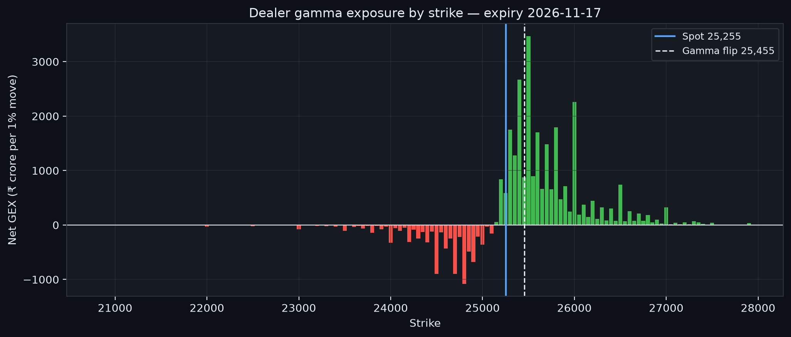

# NIFTY Research Desk

**An open-source AI analyst desk for Indian markets — regime, volatility, gamma and options flow on NIFTY & BANKNIFTY, published free every morning.**



Every morning the desk reads the previous session's end-of-day data and publishes a one-page research brief: which volatility regime the market is in, where volatility is heading, how dealers are positioned in the options chain, what the smile is charging for protection, and how BankNifty compares. The numbers are computed by real quant engines; a three-agent editorial layer writes them up — and a machine guard verifies that **every single number in the brief came out of the engines**. If a figure can't be traced to the data, the brief doesn't publish.

<!--LATEST-BRIEF-->
### Latest brief — 2026-11-09


- **NIFTY spot:** 25,255.05 (+6.8% over five sessions, +12.7% over 21 sessions)
- **Regime:** Transitional (regime unresolved) — high-volatility probability 55.5%
- **Volatility:** realised 15.9% (21 sessions); GARCH forecast 17.8% for the next session
- **Dealer gamma:** net GEX +₹18,550 cr per one-percent move; gamma flip 25,455; max pain 25,100 for the 2026-11-17 expiry
- **Smile:** ATM IV 18.0%, downside skew 15.5 points

[Read the full brief](briefs/2026-11-09.md) · [All briefs](briefs/) · [Dashboard](docs/index.html)
<!--/LATEST-BRIEF-->

## What the desk publishes

| Panel | Question it answers |
|---|---|
| **Regime** | Are we in the calm or the turbulent state? A two-state Hamilton Markov-switching model gives today's high-volatility probability, each state's volatility and expected duration. |
| **Volatility** | What just happened vs what the model expects: 21-session realised volatility against a five-session GARCH forecast path. |
| **Dealer gamma / positioning** | Net dealer gamma exposure (₹ cr per 1% move), the gamma flip level, max pain for the current expiry, put–call open-interest ratio and total open interest. |
| **Smile** | At-the-money implied volatility and the downside skew — how much extra the market pays for protection ten percent below spot. |
| **BankNifty** | The banking index on the same footing: 21-session return and realised volatility, compared with NIFTY. |

Each brief closes with **"Where the desk's own numbers disagree"** — a sceptic pass that flags internal tensions (a calm regime call against a rising vol forecast, long dealer gamma against a steep crash premium, a model lagging the tape) instead of smoothing them over.

## How it works

1. **Engines (vendored).** The quantitative core is vendored from the author's own open-source stack — the Hamilton regime-switching and GARCH models from [textbook-quant-models](https://github.com/risootooo/textbook-quant-models), and the option-chain, Greeks and gamma-exposure machinery from [greeks-lab](https://github.com/risootooo/greeks-lab). Nothing is wrapped from a quant library; the models are implemented from their papers.
2. **Three-agent editorial layer.** An *Analyst* turns the day's snapshot into structured findings per panel; a *Sceptic* cross-checks the panels against each other and flags disagreements; an *Editor* composes the brief. The agents are deterministic — templates and comparisons over the snapshot, not free-form generation — and every statement is built from snapshot values.
3. **Number-guard verification.** Before anything is written, `verify_numbers` extracts every numeral in the composed brief and checks it against the snapshot (raw values, percent forms and roundings, field-encoded window lengths, date components). A single untraceable number aborts publication. This is the desk's anti-hallucination core, and it is tested: corrupting one figure in a brief makes the check fail.

## Run it yourself

```bash
pip install -e .
python -m nifty_desk.publish --chain path/to/BhavCopy_NSE_FO.csv
```

- **Index data:** Yahoo Finance end-of-day closes for NIFTY and BANKNIFTY.
- **Options chain:** the NSE end-of-day F&O bhavcopy CSV (settlement prices and open interest) for the chain date.
- **Outputs:** `briefs/<date>.md` (the brief), `briefs/assets/*.png` (regime, volatility, gamma and smile charts), a regenerated static dashboard at `docs/index.html`, and the latest-brief block at the top of this README.

Optional: `--date YYYY-MM-DD` pins the index history end date.

## Limitations

- **End-of-day only.** The desk reads yesterday's close and yesterday's chain. It is a morning research note, not an intraday tool.
- **Settlement marks.** Bhavcopy prices are exchange settlement marks; for illiquid strikes they are theoretical prices, so the far wings of the smile are indicative.
- **Textbook models.** Two regimes, one volatility factor, one-factor gamma — deliberate simplifications that make the market's state readable at the cost of everything they leave out.
- **Positioning is inferred.** Gamma exposure assumes option sellers are predominantly dealers; it is an estimate built on a convention, not observed positioning.
- **Estimates, not observations.** Regime probabilities, forecasts and flip levels are model outputs and carry model risk; the brief prints them as such.

## Disclaimer

Research and education only — **not investment advice**. Nothing here is a recommendation to buy or sell any security, and the desk does not manage money or accept clients. All data is end-of-day and publicly sourced; verify anything you rely on against the exchange's own publications.

## Author

**Samrat Banerjee** — derivatives & quantitative research.
[LinkedIn](https://www.linkedin.com/in/samrat-banerjee-919a45447) · [GitHub profile](https://github.com/risootooo)

MIT licensed.
