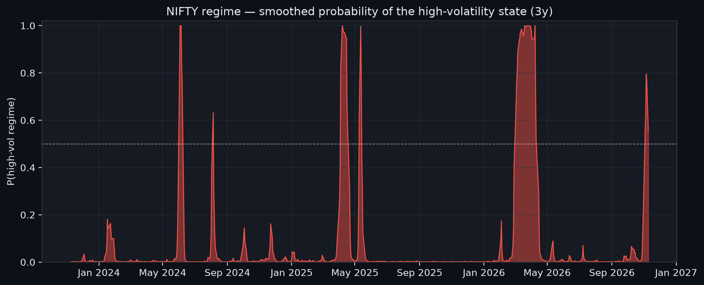
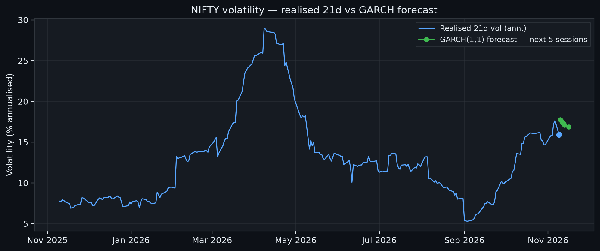
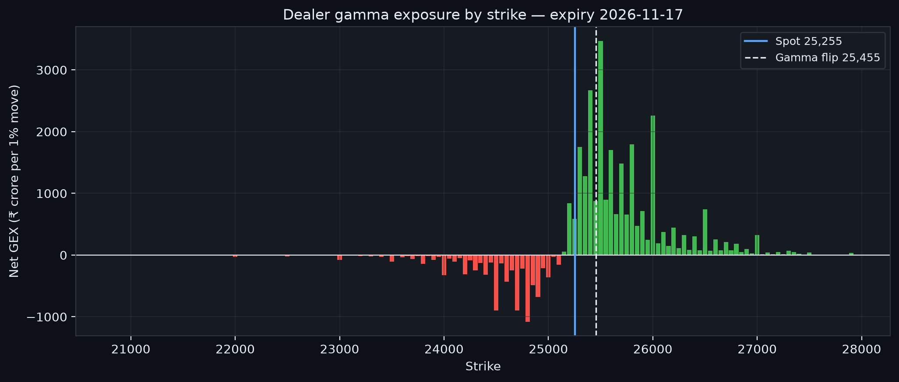
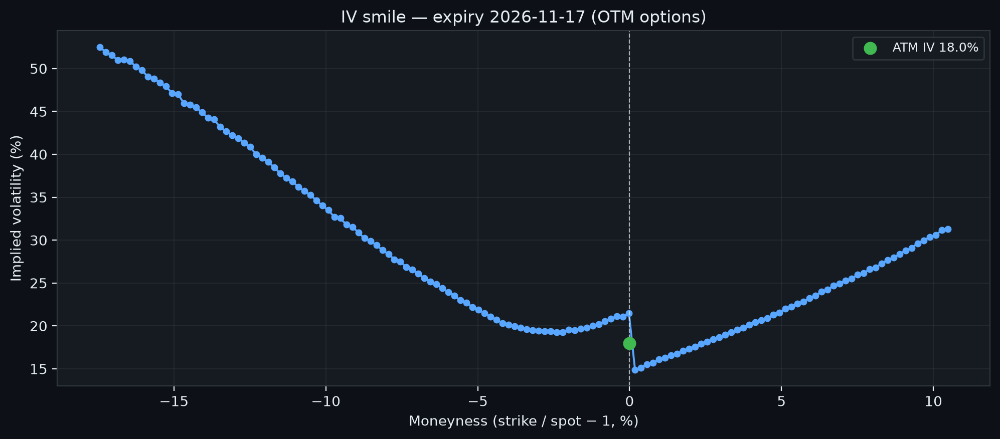

# NIFTY Research Desk — Daily Brief · 09 November 2026

An open-source AI analyst desk for Indian markets: regime, volatility, dealer gamma and the options smile on NIFTY & BANKNIFTY, computed from end-of-day data and published free every morning.

## At a glance

| Metric | Reading |
|---|---|
| NIFTY spot | 25,255.05 |
| Regime | Transitional (regime unresolved) — high-volatility probability 55.5% |
| NIFTY return, five sessions | +6.8% |
| NIFTY return, 21 sessions | +12.7% |
| GARCH vol forecast, next session | 17.8% annualised |
| Realised vol, 21 sessions | 15.9% annualised |
| Net dealer GEX | +₹18,550 cr per one-percent move |
| Gamma flip | 25,455 |
| Max pain (expiry 2026-11-17) | 25,100 |
| ATM implied vol | 18.0% |

## Regime

**Regime: unresolved — high-volatility probability 55%**

The two-state Markov-switching model puts the probability of the high-volatility state today at 55.5%. In the calm state annualised volatility runs at 11.7% with an expected duration of 69 sessions; in the turbulent state it runs at 35.1% with an expected duration of 9 sessions. Over the past year the index spent 12% of sessions in the high-volatility state. Current state: Transitional (regime unresolved).

## Volatility

**Volatility: realised 15.9%, forecast path easing**

Realised volatility over the last 21 sessions annualises to 15.9%. The GARCH forecast for the next five sessions starts at 17.8% and ends at 16.9% — an easing path. Realised volatility is running below the model's near-term path. The fitted shock and persistence parameters are 0.08 and 0.87 respectively.

## Dealer gamma / positioning

**Positioning: net GEX +₹18,550 cr per one-percent move, flip at 25,455**

Net dealer gamma exposure is +₹18,550 cr for a one-percent move in the index: dealers are net long gamma, a posture that usually dampens moves — hedging flows lean against the trend and ranges tend to be sold. The gamma flip level is 25,455 and spot at 25,255.05 is below it — spot sits below the flip, in the zone where dealer hedging can amplify moves. Max pain for the 2026-11-17 expiry is 25,100; max pain sits below spot, so the expiry pin — the level at which aggregate option-holder losses peak — is underneath. The put-call open-interest ratio is 0.77 across total open interest of 4,096,096 lots.

## Smile

**Smile: ATM IV 18.0%, downside skew 15.5 points**

At-the-money implied volatility is 18.0%. The implied volatility of the option struck ten percent below spot sits 15.5 points above that level: that is a steep crash premium — downside protection is being bid hard relative to the at-the-money level.

## BankNifty

**BankNifty: +9.6% over 21 sessions, realised vol 17.3%**

BANKNIFTY closed at 59,741.25, a +9.6% move over the last 21 sessions. Its realised volatility over the same window annualises to 17.3%, running hotter than the headline index (NIFTY realised 15.9%).

## Where the desk's own numbers disagree

- Dealers are strongly long gamma (net GEX +₹18,550 cr per one-percent move), which usually dampens swings — yet the downside skew is priced at 15.5 points, a crash premium that calm positioning alone does not explain.

## Method and data

Index data as of 2026-11-09 (Yahoo Finance end-of-day closes). Options chain dated 2026-11-11 (NSE end-of-day bhavcopy, settlement marks), expiry 2026-11-17. The regime panel is a two-state Gaussian Markov-switching model (Hamilton) fitted by expectation-maximisation; the volatility panel is a GARCH forecast beside realised volatility; dealer gamma, the gamma flip and max pain are computed from open interest and Black-Scholes greeks across the chain; the smile is read from implied volatilities inverted strike by strike. Every number in this brief is produced by those engines and is machine-checked against the underlying snapshot before publication — the desk's agents may phrase the numbers, but they may not invent them.

## Limitations

- End-of-day data only: nothing here is intraday, and the chain is a settlement snapshot, not a live book.
- Settlement marks for illiquid strikes are exchange-computed theoretical prices, so the far wings of the smile are indicative.
- The models are deliberately textbook and low-dimensional: two regimes, one volatility factor, one-factor gamma. They simplify the market to make its state readable, at the cost of everything they leave out.
- Gamma exposure rests on the convention that option sellers are predominantly dealers; positioning estimates are inferences, not observations.

---
*Research and education only — not investment advice. This brief describes the state of the market as measured by the desk's models; it is not a recommendation to buy or sell any security. All data is end-of-day.*
